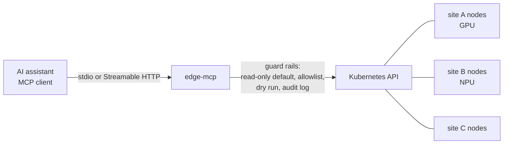

# edge-mcp

**Talk to your edge fleet.** An [MCP](https://modelcontextprotocol.io) server that lets AI assistants inspect, and carefully operate, Kubernetes clusters running at the edge: many small nodes spread across sites, with GPUs and NPUs, flaky links and nobody on site.

[](https://github.com/xudipta/edge-mcp/actions/workflows/ci.yml)
[](go.mod)
[](LICENSE)

```text
You:       Which of my stores have problems right now?

Assistant  → cluster_overview
           → list_edge_nodes {"unhealthy_only": true}
           → describe_edge_node {"name": "blr-02"}

           1 of 5 nodes needs attention: blr-02 at store-blr has been NotReady for
           9 minutes (last heartbeat 9m ago). Its site still has blr-01 serving.
           Separately, vision/defect-detector is degraded (2/3 ready): pod
           defect-detector-c on pune-02 is in CrashLoopBackOff with 7 restarts.
           Want me to pull its previous logs, or cordon blr-02 (dry run first)?
```

## Why

Generic Kubernetes tools assume one big cluster in a data centre. Edge fleets are different:

- **Sites matter.** "Is the Bangalore store OK?" is the real question, not "is node 7 OK?".
- **Heartbeats go stale.** A node on a 4G link can look Ready while it hasn't reported in for minutes.
- **Accelerators are the point.** You need to know which nodes still have their GPU or NPU available.
- **Mistakes are expensive.** A bad command can take down a store with no engineer on site, so writes must be opt-in, dry-run first and audited.

edge-mcp gives an assistant edge-shaped answers and keeps it on a short leash.

## Tools

| Tool | What it answers | Mode |
|---|---|---|
| `cluster_overview` | Nodes ready per site, nodes needing attention, accelerators across the fleet, pod health, latest warnings | read |
| `list_edge_nodes` | Site, readiness, heartbeat age, pressure, taints, OS/kubelet versions, GPUs/NPUs. Filter by `site` or `unhealthy_only` | read |
| `describe_edge_node` | One node, its pods (restarts, `CrashLoopBackOff` reasons) and its recent events | read |
| `list_workloads` | Deployments, DaemonSets, StatefulSets with desired/ready/available; `unhealthy_only` | read |
| `list_events` | Recent events, newest first, warnings only by default | read |
| `get_pod_logs` | Tail of a container log (max 500 lines), including `previous` after a crash | read |
| `cordon_node` / `uncordon_node` | Stop or resume scheduling on a node | write, opt-in |
| `restart_workload` | Rolling restart (like `kubectl rollout restart`) | write, opt-in |
| `scale_deployment` | Change replicas, capped by `--max-replicas` | write, opt-in |

Every tool returns structured JSON (with an output schema) plus text, so it works with any MCP client.

## Safety model

- **Read-only by default.** Write tools are not even registered unless you start the server with `--allow-writes`.
- **Dry run by default.** Every write tool defaults to `dry_run: true`, which sends a real server-side dry run (`dryRun=All`) to Kubernetes. The assistant is told to show you the dry-run result and wait for your go-ahead before calling again with `dry_run: false`.
- **Audited.** Every action requires a `reason` and is logged (action, target, dry run, reason) to stderr.
- **Scoped.** `--namespaces` restricts every namespaced read and write to an allowlist. Secrets and ConfigMaps are never read.
- **Bounded.** Logs are capped at 500 lines and 256 KiB per call; `scale_deployment` is capped by `--max-replicas`.
- **Honest annotations.** Tools carry MCP `readOnlyHint` / `destructiveHint` annotations so clients can gate them.
- **Least privilege.** Ready-made [read-only](deploy/rbac-readonly.yaml) and [operator](deploy/rbac-operator.yaml) RBAC roles.

## Install

Download a prebuilt binary (linux and macOS on amd64/arm64, Windows on amd64) from the [latest release](https://github.com/xudipta/edge-mcp/releases/latest). For example, on a linux/arm64 edge device:

```sh
VERSION=v0.1.0   # see the releases page
curl -fsSL -o edge-mcp.tar.gz "https://github.com/xudipta/edge-mcp/releases/download/${VERSION}/edge-mcp_${VERSION}_linux_arm64.tar.gz"
tar -xzf edge-mcp.tar.gz && sudo install "edge-mcp_${VERSION}_linux_arm64/edge-mcp" /usr/local/bin/
edge-mcp --version
```

Each release includes `checksums.txt` (SHA-256). Or, with a Go toolchain: `go install github.com/xudipta/edge-mcp/cmd/edge-mcp@latest`.

## Quick start

### 1. Try it without a cluster

```sh
go install github.com/xudipta/edge-mcp/cmd/edge-mcp@latest
edge-mcp --demo
```

`--demo` serves a built-in sample fleet: 5 nodes across 3 sites, Intel GPU and NPU nodes, one offline node and one crash-looping app.

### 2. Connect it to your AI assistant

**Claude Code**

```sh
claude mcp add edge-mcp -- edge-mcp --demo
# against a real cluster:
claude mcp add edge-mcp -- edge-mcp --context my-edge-cluster
```

**Claude Desktop, Cursor, VS Code and other MCP clients** (JSON config):

```json
{
  "mcpServers": {
    "edge-mcp": {
      "command": "edge-mcp",
      "args": ["--context", "my-edge-cluster", "--namespaces", "vision,retail"]
    }
  }
}
```

### 3. Point it at a real cluster

edge-mcp uses your kubeconfig like `kubectl` does (`--kubeconfig`, `$KUBECONFIG`, `~/.kube/config`, or the in-cluster service account). It works with any conformant cluster, including k3s, MicroK8s, KubeEdge and kind.

Tell it which node label names your sites (default `topology.kubernetes.io/zone`):

```sh
edge-mcp --site-label example.com/site
```

### 4. Allow actions (optional)

```sh
edge-mcp --allow-writes --namespaces vision,retail --max-replicas 10
```

## Configuration

| Flag | Default | Description |
|---|---|---|
| `--kubeconfig` | kubectl rules | Path to a kubeconfig |
| `--context` | current context | Kubeconfig context |
| `--site-label` | `topology.kubernetes.io/zone` | Node label that names a node's site |
| `--namespaces` | all | Comma-separated namespace allowlist |
| `--stale-heartbeat` | `2m` | Flag nodes whose last heartbeat is older than this |
| `--allow-writes` | `false` | Register cordon/uncordon/restart/scale tools |
| `--max-replicas` | `20` | Upper bound for `scale_deployment` |
| `--http` | (stdio) | Serve Streamable HTTP on an address such as `127.0.0.1:8080` |
| `--http-token` | `$EDGE_MCP_TOKEN` | Require `Authorization: Bearer <token>` on every HTTP request |
| `--http-insecure` | `false` | Allow `--http` on a non-loopback address without a token |
| `--demo` | `false` | Use the built-in sample fleet instead of a cluster |

> **Exposing HTTP mode takes a deliberate choice.** Binding to a non-loopback address is refused unless you set `--http-token` (or `EDGE_MCP_TOKEN`) or pass `--http-insecure`. Prefer a token, and terminate TLS in front of edge-mcp: bearer tokens are sent in clear text over plain HTTP.

## Run it in the cluster

```sh
kubectl apply -f deploy/rbac-readonly.yaml   # or deploy/rbac-operator.yaml
docker build -t edge-mcp .
```

Run the image with the `edge-mcp` service account and `--http 0.0.0.0:8080`, supplying the token from a Secret (`EDGE_MCP_TOKEN`), behind your TLS-terminating ingress. Clients send `Authorization: Bearer <token>`.

## How it works



- `internal/edge`: edge views (sites, heartbeats, accelerators) and guarded actions on top of `client-go`
- `internal/server`: MCP tools on the official [Go SDK](https://github.com/modelcontextprotocol/go-sdk)
- `internal/edgetest`: the sample fleet used by tests and `--demo`

## Development

```sh
make test     # unit + end-to-end MCP tests against a fake fleet
make lint     # gofmt + go vet
make build    # ./bin/edge-mcp
make demo     # run against the sample fleet
```

See [CONTRIBUTING.md](CONTRIBUTING.md) for how to add a tool, and [SECURITY.md](SECURITY.md) to report a vulnerability.

## Roadmap

- [ ] Multi-cluster: query every context in a kubeconfig as one fleet
- [ ] Accelerator telemetry: GPU/NPU utilisation from device-plugin and Prometheus metrics
- [ ] `drain_node` with PodDisruptionBudget checks
- [ ] Site-level rollout status for DaemonSets
- [ ] MCP resources for node and workload snapshots
- [ ] Prebuilt binaries and a container image on each release

Contributions are welcome. Open an issue to discuss bigger changes first.

## License

[Apache 2.0](LICENSE)
